# Steinel L620/L620 SC Camera

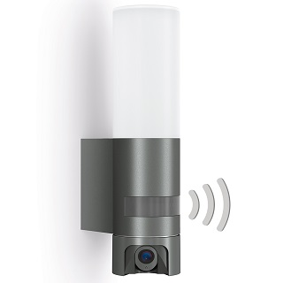

- [X] Access to the Camera via Serial
- [X] Analyse Original Firmware
- [X] Install OpenIPC Using Serial
- [X] Active Wifi Card and networking
- [X] Active Sensor
- Manage communication with light extension card over webservice
   - [X] Expose detector status
   - [X] give light control : ON/OFF/Variable
   - [X] manage light parameters : ON/OFF management, Light %,...
   - [X] Manage detector parameters: sensitivity, duration,...
- [X] Create a Migration Procedure without using Serial

## Camera dismounting and hardware identification

Dismounting Steinel cameras is quite hard, and does not seem feasible without breaking a foot of the camera support. This confirms the need to develop a script to install a new firmware without opening the camera. All connectors are glued (the glue can be removed, sometimes breaking a connector...).

### Steinel L620 (SC) camera is based on this hardware
- SoC : Hisilicon HI3518EV300
- Device ID : 50H20L
- Sensor : SC2315E (L620 SC), SC2235P (L620)
- Flash : NOR 16MB W25Q128JV (SSOP20 format)
- Wifi Card : Realtek RTL8188FU
- Light management card: see below

### Wiring diagram of the light

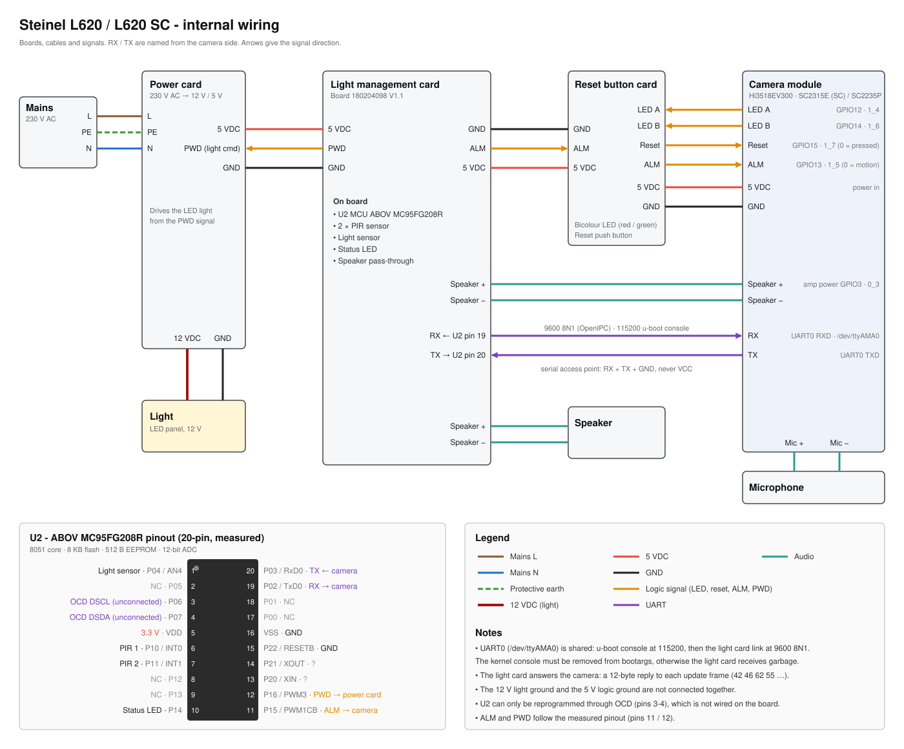

### Photos

Camera Module

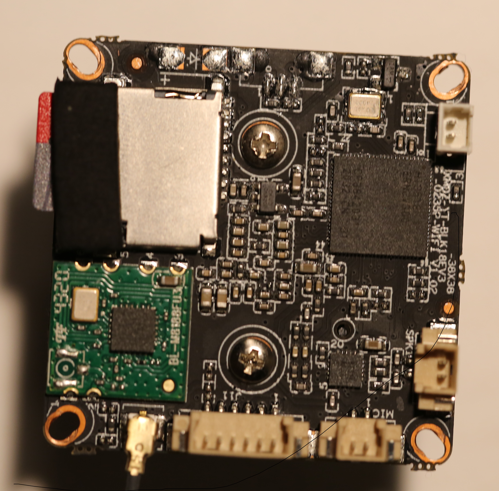
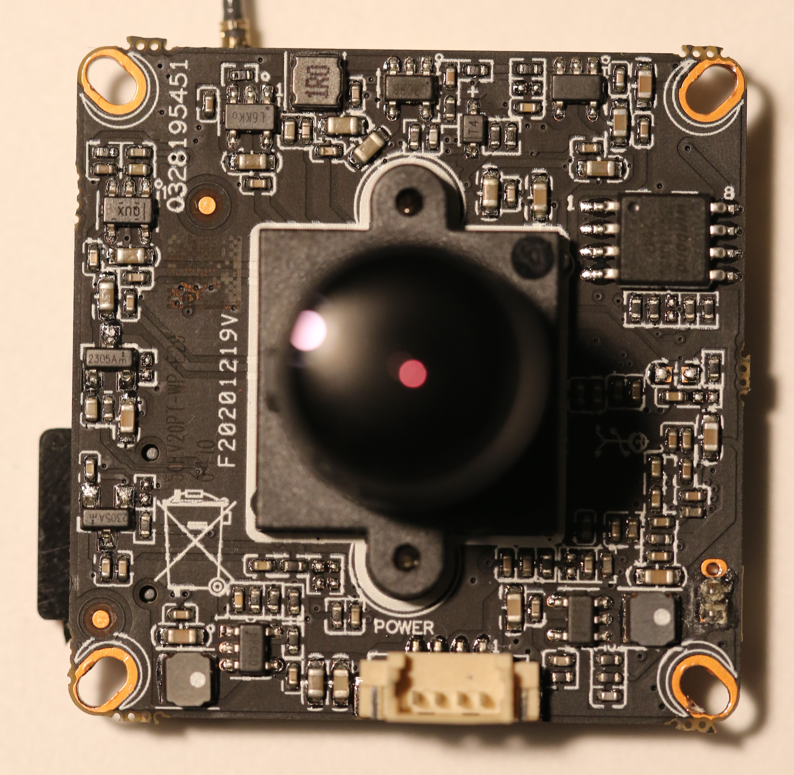

Reset Button card

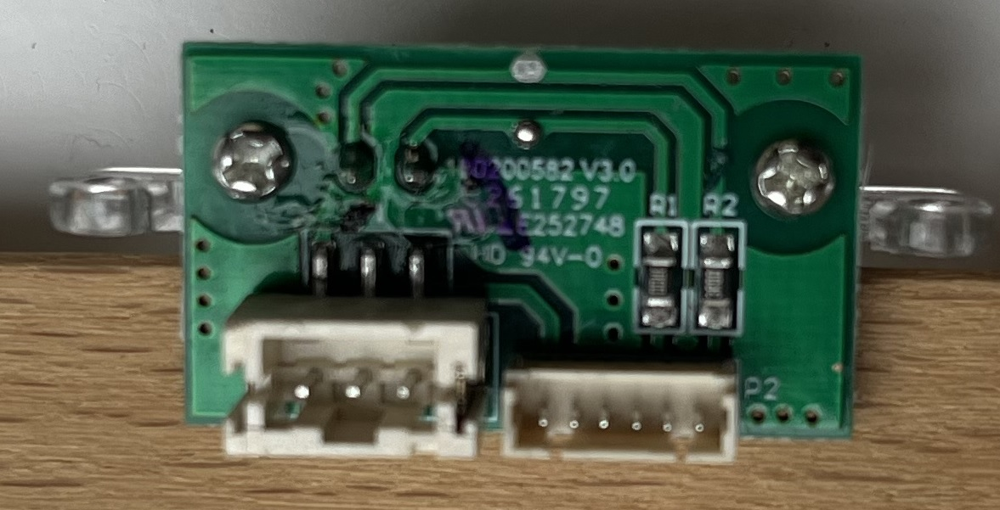
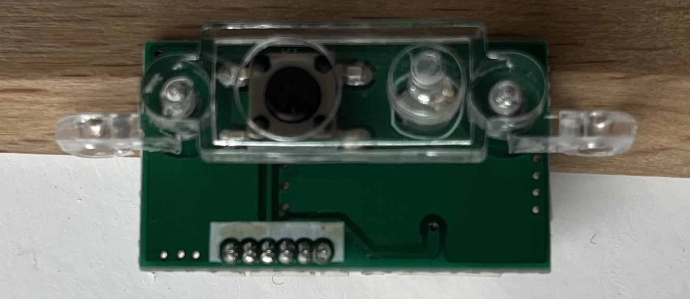

Light Management card

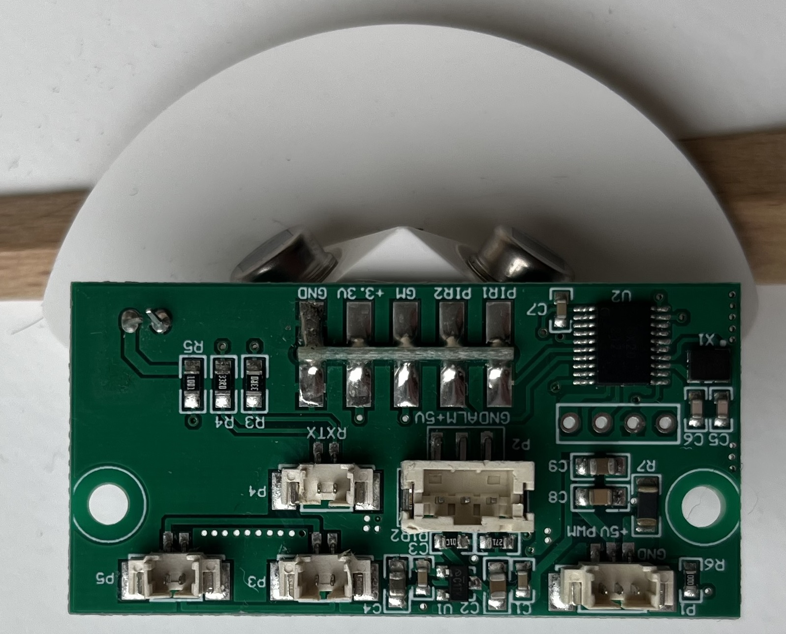
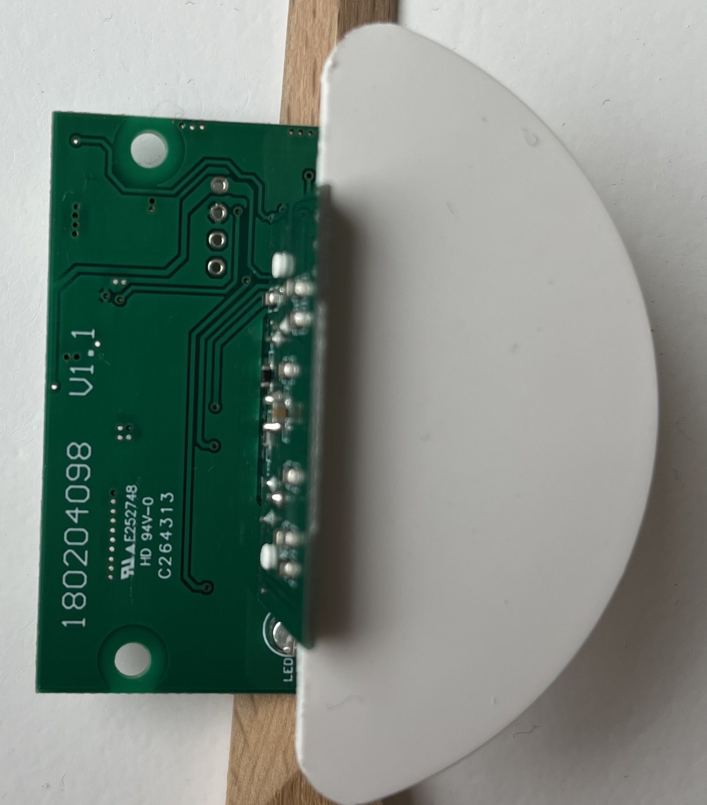
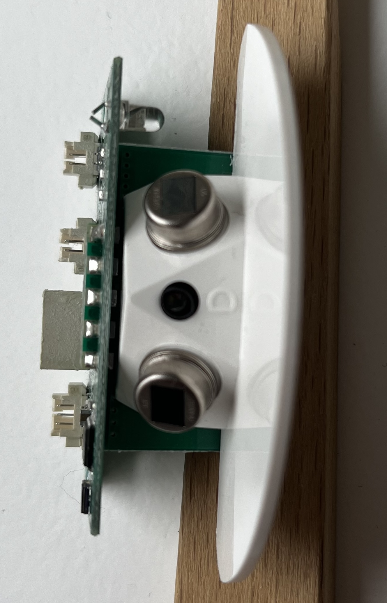
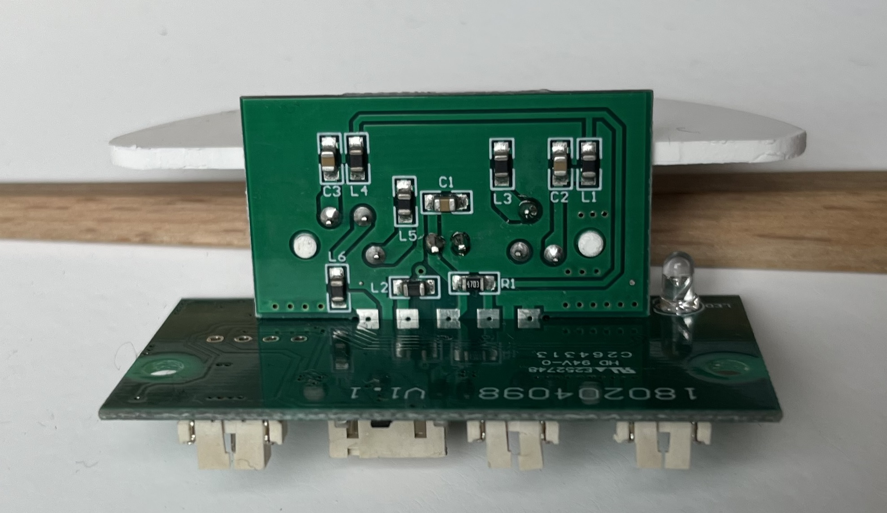


## identification of console serial port and connection

### generalities

The communication between the camera module and the light management extension card is done via a UART port. It appears that this UART port is the console serial port.
The port is only used as a console at u-boot level. The kernel uses this serial port for light management.

UART configuration at u-boot level for console : speed 115200 - ASCII

UART configuration at kernel level for communication with light card : speed 9600 - Hex Byte

UART configuration at kernel level for console : speed 115200 - ASCII

The communication was done with a 3.3VDC serial TTL USB adapter. RX/TX and GND are connected to the camera board. Notice that GND is connected on all boards, but 5VDC/3.3VDC GND, 12VDC GND (light) and main power GND are not connected.

### u-boot connection

Using a serial communication with PuTTY, it is possible to interrupt boot at u-boot level by pressing Ctrl+c.

Here is the full u-boot output on firmware 20220712

```
System startup

Uncompress Ok!

U-Boot 2016.11+ (Nov 23 2019 - 14:15:27 +0800)hi3518ev300

Relocation Offset is: 036ea000
Relocating to 43eea000, new gd at 43ea9ef0, sp at 43ea9ed0
SPI Nor:  eFlashType: 3.
Flash Name: XM_W25Q128FV, W25Q128JV{0xEF4018), 0x1000000.
@hifmc_spi_nor_probe(), XmSpiNor_ProtMgr_probe(): OK.
@XmSpiNor_enableQuadMode(), Disable Quad Failed, SRx: [2, 0x2].
CONFIG_CLOSE_SPI_8PIN_4IO = y.
read->iftype[0: STD, 1: DUAL, 2: DIO, 3: QUAD, 4: QIO]: 1.
lk=>6, 0x800000.
SRx val: {[1, 0x38], [1, 0x2], [1, 0x60], [0, 0x0]}, SrVal: 0x700000000600238.
MMC:   hisi-sdhci: 0 (SD)
In:    serial
Out:   serial
Err:   serial
Net:   eth0
Hit ctrl+c to stop autoboot:  0
@do_spi_flash_probe() flash->erase_size:65536
device 0 offset 0x40000, size 0x550000

SF: 5570560 bytes @ 0x40000 Read: OK
srcAddr 0x43000000, dstAddr 0x42000000
created_inode 0x43eaba40
find_squashfs_file: name bin, start_block 0, offset 2111, type 1
find_squashfs_file: name boot, start_block 0, offset 2207, type 1
read inode: name boot, sb 0, of 2207, type 1
find_squashfs_file: name uImage, start_block 0, offset 2143, type 2
read inode: name uImage, sb 0, of 2143, type 2
write_file: regular file, blocks 8
len 1954007
### FS load complete: 1954007 bytes loaded to 0x42000000
## Booting kernel from Legacy Image at 42000000 ...
   Image Name:   Linux-4.9.37
   Image Type:   ARM Linux Kernel Image (uncompressed)
   Data Size:    1953943 Bytes = 1.9 MiB
   Load Address: 40008000
   Entry Point:  40008000
   Loading Kernel Image ... OK

Starting kernel ...

Uncompressing Linux... done, booting the kernel.
```

Here is the list of the available u-boot commands

```
hisilicon # help
?       - alias for 'help'
base    - print or set address offset
bitwait - bit compare and wait for equal
boot    - boot default, i.e., run 'bootcmd'
bootd   - boot default, i.e., run 'bootcmd'
bootm   - boot application image from memory
bootp   - boot image via network using BOOTP/TFTP protocol
clearenv- clear env partition.
cmp     - memory compare
cp      - memory copy
crc32   - checksum calculation
dcache  - enable or disable data cache
ddr     - ddr training function
dispaddr- display the value of 'addr'
dispenv - display the value of 'env_var'
dispver - display the uboot version
env     - environment handling commands
erase   - erase FLASH memory
exit    - exit script
false   - do nothing, unsuccessfully
fatinfo - print information about filesystem
fatload - load binary file from a dos filesystem
fatls   - list files in a directory (default /)
fatsize - determine a file's size
flinfo  - print FLASH memory information
flwrite - SPI flash sub-system
getinfo - print hardware information
go      - start application at address 'addr'
gzwrite - unzip and write memory to block device
help    - print command description/usage
icache  - enable or disable instruction cache
loadb   - load binary file over serial line (kermit mode)
loadx   - load binary file over serial line (xmodem mode)
loady   - load binary file over serial line (ymodem mode)
loop    - infinite loop on address range
md      - memory display
mii     - MII utility commands
mm      - memory modify (auto-incrementing address)
mmc     - MMC sub system
mmcinfo - display MMC info
mw      - memory write (fill)
nm      - memory modify (constant address)
part    - disk partition related commands
ping    - send ICMP ECHO_REQUEST to network host
printenv- print environment variables
protect - enable or disable FLASH write protection
pxe     - commands to get and boot from pxe files
reset   - Perform RESET of the CPU
run     - run commands in an environment variable
saveenv - save environment variables to persistent storage
setenv  - set environment variables
sf      - SPI flash sub-system
showvar - print local hushshell variables
sleep   - delay execution for some time
squashfsload- fsload  - load binary file from a filesystem image

sysboot - command to get and boot from syslinux files
test    - minimal test like /bin/sh
tftpboot- boot image via network using TFTP protocol
true    - do nothing, successfully
unzip   - unzip a memory region
version - print monitor, compiler and linker version
waitus  - wait for n us
```

### kernel connection

As explained above, the serial console is not activated at kernel level, as it is used for the configuration of the light extension card. But for analysis purposes, we can temporarily activate the serial console to access the kernel. This can be done by adding the following u-boot environment variable:

```
setenv xmuart 0; saveenv
reset
```
The result is a kernel console at a baudrate of 115200.

After reboot, it will be possible to connect with the root login.
The password can be identified by searching the Internet for the password hash found in the passwd file
```
# cat /etc/passwd
root:$1$RYIwEiRA$d5iRRVQ5ZeRTrJwGjRy.B0:0:0:root:/:/bin/sh
```
The result is the following :
```
root:xmhdipc
```
Then we get a full root access to the firmware.

## original firmware backup

### create a backup

Using u-boot with the serial console and a sd card, it is possible to make a backup of the original firmware.

```
# select sd card dev 0
mmc dev 0

# erase sd card
mmc erase 0x10 0x8000

#  erase ram
mw.b 0x42000000 ff 0x1000000; 

# select rom device
sf probe 0; 

# copy whole rom to ram
sf read 0x42000000 0x0 0x1000000;

# write ram to sd card in block mode
mmc write 0:1 0x42000000 0x10 0x8000

```

Move the SD Card to a Linux machine and run (identify dev path of sd card, /dev/sdb in this case) :

```
sudo dd bs=512 skip=16 count=32768 if=/dev/sdb of=./fulldump20220712.bin
```


### restore the backup

Using u-boot (openipc or original) and a sd card in FAT32 with fulldump20220712.bin

```
mw.b 0x42000000 ff 0x1000000;
fatload mmc 0:1 0x42000000 fulldump20220712.bin
sf probe 0;
sf lock 0;
sf erase 0x0 0x1000000;
sf write 0x42000000 0x0 0x1000000;
```
## Activate telnetd

Telnetd is part of busybox binary.
To be able to analyze the running firmware with the Light management extension card, it is necessary to remotely access the console with telnet, and disable the console on the serial port. Following some CVE alerts, most small device firmwares have disabled all backdoors. So to activate telnet, the following actions need to be done:

### Add u-boot telnetctrl variable

This variable can be added from u-boot or from the kernel

From u-boot

```
setenv telnetctrl 1; saveenv
reset
```

From Kernel

```
XmEnv -s telnetctrl 1
```

### Start telnetd and allow Lan access

By default, when activating telnetd and trying to connect, you will get a Connection Rejected error. This is because telnet seems to be enabled only for connections through WAN (native VPN?). By analysing the busybox binary we can find a reference to a file at /var/Telnetd_WanCheckFlag.
Indeed, by manually creating this file, we can observe that it is deleted when telnetd is starting. But when creating it after the call of telnetd, Lan telnet clients are allowed. So the following script will enable telnetd for local client:

```
# set environnement variable to enable telnet (could need a reboot)
XmEnv telnetctrl 1

# start telnetd
telnetd 
sleep 1

# need to exist after start of telnetd to allow local telnet connexion
touch /var/Telnetd_WanCheckFlag
```
By investigating the kernel we can find this file that contains the account allowed for telnet
```
# cat /etc/xmtelnetdpw
root:$1$RYIwEiRA$d5iRRVQ5ZeRTrJwGjRy.B0:0:0:root:/:/bin/sh
```
Fortunately the hash of the root password is the same as in /etc/passwd.
Then a remote client can connect to the IPC using the same root login and password.

```
$ telnet 192.168.1.168
Trying 192.168.1.168...
Connected to 192.168.1.168.
Escape character is '^]'.
LocalHost login: root
Password:
Welcome to HiLinux.
# ls
bin      dev      home     linuxrc  opt      root     sys      usr      var
boot     etc      lib      mnt      proc     sbin     tmp      utils
```

## original firmware deep inside

Firmware analyzed: 07.12.2022 (the one backed up with the previous method).

### offline extracting firmware

Extracting the firmware using binwalk (additional extraction tools may need to be installed. Check binwalk output).
This extraction gives the possibility to find any text or file in the firmware.

```
binwalk -e fulldump20220712.bin
```

The result should be a folder with all the different partitions and the content of the original firmware.
Here is a useful grep command to find a specific text in the whole firmware ('root' in this example) :

```
$ grep -rnw './' -e 'root'
grep: ./u-boot.bin: binary file matches
grep: ./cramfs-root/lib/modules/hi3516ev200_sys.ko: binary file matches
./cramfs-root/sbin/udhcpd.conf:91:#opt rootpath   STRING                # (NFS) path to mount as root fs
grep: ./cramfs-root/bin/Sofia: binary file matches
./squashfs-root/etc/xmtelnetdpw:1:root:$1$RYIwEiRA$d5iRRVQ5ZeRTrJwGjRy.B0:0:0:root:/:/bin/sh
./squashfs-root/etc/mdev.conf:1:mmcblk[0-9]p[0-9] root:root     660 */etc/mdev/automount.sh
./squashfs-root/etc/mdev.conf:2:mmcblk[0-9] root:root     660 */etc/mdev/automount.sh
./squashfs-root/etc/passwd:1:root:$1$RYIwEiRA$d5iRRVQ5ZeRTrJwGjRy.B0:0:0:root:/:/bin/sh
./squashfs-root/etc/inittab:77:::respawn:/sbin/getty -L ttyS000 115200 vt100 -n root -I "Auto login as root ..."
./squashfs-root/etc/group:1:root::0:
./squashfs-root/etc/passwd-:1:root:$6$0E8/0opc$yfESwbvIce8PIEb3fCgH1kRpISzA2ffyv9VfdeM3wadmKyLfLXgNlyH3TafXvugdqPevBgE.3EZtGnP.KZZug.:0:0:root:/:/bin/sh
grep: ./squashfs-root/bin/XmSearchIp: binary file matches
grep: ./squashfs-root/bin/busybox: binary file matches
```

### FirmwareInfo from kernel

```
# cat /mnt/custom/FirmwareInfo
PRODUCT_NAME=HI3518EV300_50H20L_16M_IPC_8188FTVHISI_PED_XMJP_NONE_NONE_SimpChn_NP_CamLight_V1.000.00.0.R
CHIP_ID=HI3518EV300
DEVICE_ID=50H20L
FLASH_SIZE=16M
PRODUCTION_TYPE=IPC
EXTENFUNC=8188FTV,HISI_PED
NATURE=XMJP
DEVICEEXT_ID=NONE
INTELLIGENT=NONE
LANGUAGES=SimpChinese
VIDEOSTANDARDS=PAL,NTSC
DEFAULT_VIDEOSTANDARD=NTSC
VSP=CamLight
NET_UPGRADE_FILE=General_CamLight_IPC_HI3518EV300_50H20L_8188FU_V4.03.R12.Nat.20221207_ALL.bin
BURN_FILE=upall_IPC_HI3518EV300_50H20L_8188FU.Nat.20221207.bin
```

### printenv from u-boot

```
hisilicon # printenv
NID=0x0001
appCloudExAbility=toaXOp2PN2M=
appSystemLanguage=English
appVideoStandard=PAL
baudrate=115200
bootargs=init=linuxrc mem=${osmem} console=ttyAMA0,115200 root=/dev/mtdblock1 rootfstype=squashfs mtdparts=hi_sfc:0x40000(boot),0x540000(romfs),0x740000(user),0x180000(web),0x80000(custom),0x140000(mtd)
bootcmd=setenv setargs setenv bootargs ${bootargs};run setargs;sf probe 0;sf read 43000000 40000 550000;squashfsload;bootm 0x42000000
bootdelay=0
bootfile="uImage"
da=mw.b 0x42000000 ff 1000000;setenv loadaddr 0x42000000;setenv bootfile u-boot.bin.img;fatload mmc 0;sf probe 0;flwrite
dc=mw.b 0x42000000 ff 1000000;setenv loadaddr 0x42000000;setenv bootfile custom-x.cramfs.img;fatload mmc 0;sf probe 0;flwrite
dd=mw.b 0x42000000 ff 1000000;setenv loadaddr 0x42000000;setenv bootfile mtd-x.jffs2.img;fatload mmc 0;sf probe 0;flwrite
de=mw.b 0x42000000 ff 1000000;setenv loadaddr 0x42000000;setenv bootfile u-boot.env.img;fatload mmc 0;sf probe 0;flwrite
dl=mw.b 0x42000000 ff 1000000;setenv loadaddr 0x42000000;setenv bootfile logo-x.cramfs.img;fatload mmc 0;sf probe 0;flwrite
dr=mw.b 0x42000000 ff 1000000;setenv loadaddr 0x42000000;setenv bootfile romfs-x.cramfs.img;fatload mmc 0;sf probe 0;flwrite
du=mw.b 0x42000000 ff 1000000;setenv loadaddr 0x42000000;setenv bootfile user-x.cramfs.img;fatload mmc 0;sf probe 0;flwrite
dw=mw.b 0x42000000 ff 1000000;setenv loadaddr 0x42000000;setenv bootfile web-x.cramfs.img;fatload mmc 0;sf probe 0;flwrite
ethact=eth0
ethaddr=00:12:31:88:dc:38
gatewayip=192.168.1.1
gpio0=0x14
gpio1=0x16
gpio2=0x17
gpio3=0x3
gpioval0=0x0
gpioval1=0x1
gpioval2=0x0
gpioval3=0x0
ipaddr=192.168.1.10
muxctl0=0x120c0010
muxctl1=0x120c0018
muxctl2=0x120c001c
muxctl3=0x100c000c
muxval0=0x1e02
muxval1=0x1d02
muxval2=0x1502
muxval3=0x1000
netmask=255.255.0.0
osmem=43M
serverip=192.168.1.107
stderr=serial
stdin=serial
stdout=serial
tk=setenv loadaddr 0x42000000;setenv bootfile uImage;fatload mmc 0;setenv setargs setenv bootargs ${bootargs};run setargs;bootm 0x42000000
ua=mw.b 0x42000000 ff 1000000;setenv loadaddr 0x42000000;setenv bootfile upall_verify.img;fatload mmc 0;sf probe 0;flwrite
up=mw.b 0x42000000 ff 1000000;setenv loadaddr 0x42000000;setenv bootfile update.img;fatload mmc 0;sf probe 0;flwrite
ver=U-Boot 2016.11 (Oct 29 2018 - 16:06:3
verify=n

Environment size: 2390/65532 bytes
```

### Partitions structure

From the bootargs variable,

```
hi_sfc:0x40000(boot),0x540000(romfs),0x740000(user),0x180000(web),0x80000(custom),0x140000(mtd)
```

and the mount command (see below how to get access to the kernel terminal), 
```
# mount
/dev/root on / type squashfs (ro,relatime)
proc on /proc type proc (rw,relatime)
sysfs on /sys type sysfs (rw,relatime)
tmpfs on /dev type tmpfs (rw,relatime)
devpts on /dev/pts type devpts (rw,relatime,mode=600,ptmxmode=000)
/dev/mtdblock2 on /usr type cramfs (ro,relatime)
/dev/mtdblock3 on /mnt/web type cramfs (ro,relatime)
/dev/mtdblock4 on /mnt/custom type cramfs (ro,relatime)
/dev/mtdblock5 on /mnt/mtd type jffs2 (rw,relatime)
/dev/mem on /var type ramfs (rw,relatime)
/dev/mem2 on /utils type ramfs (rw,relatime)
/dev/mtdblock2 on /mnt/custom/data/Fonts type cramfs (ro,relatime)
/dev/mmcblk0 on /var/tmp/mmcblock0 type vfat (rw,relatime,fmask=0022,dmask=0022,codepage=437,iocharset=iso8859-1,shortname=mixed,errors=remount-ro)
```
we can analyze the partitions structure of the ROM

| Part   | size (KB) | start address | Hex Size (bytes) | end address | dev point      | mount point      |
|--------|-----------|---------------|------------------|-------------|----------------|------------------|
| boot   | 192       |      0x0      | 0x30000          |  0x2FFFF    |                |                  |
| env    | 64        |  0x30000      | 0x10000          |  0x3FFFF    |                |                  |
| romfs  | 5376      |  0x40000      | 0x540000         | 0x57FFFF    | /dev/root      | / (ro)           |
| user   | 7424      | 0x580000      | 0x740000         | 0xCBFFFF    | /dev/mtdblock2 | /usr (ro)        |
| web    | 1536      | 0xCC0000      | 0x180000         | 0xE3FFFF    | /dev/mtdblock3 | /mnt/web (ro)    |
| custom | 512       | 0xE40000      |  0x80000         | 0xEBFFFF    | /dev/mtdblock4 | /mnt/custom (ro) |
| mtd    | 1280      | 0xEC0000      | 0x140000         | 0x9FFFFF    | /dev/mtdblock5 | /mnt/mtd (rw)    |

### Starting sequence

By analysing the script /etc/init.d/rcS, we can see that it manages the call to an autorun script on the SD Card

```
<fun_init definition>
<fun_insmod_modules definition>
<fun_start_app definition>

#############################################################

. /etc/init.d/dnode

echo /sbin/mdev > /proc/sys/kernel/hotplug
mdev -s

#mkdir -p /dev/.udev
#udevd --daemon
#udevadm trigger

fun_init

fun_insmod_modules

echo "LD_LIBRARY_PATH: $LD_LIBRARY_PATH"

XmServices_Mgr /lib/modules /usr/sbin/SofiaRun.sh 127.0.0.1 9578 1  # not add '&', it has invoked fork internally

#netinit if=eth0  # netinit add to XmServices_Mgr

mkdir -p /var/tmp/mmcblock0
mount /dev/mmcblk0 /var/tmp/mmcblock0
if [ -f /var/tmp/mmcblock0/xm_autorun.sh ];then
        [ ! -z `command -v XmSearchIp` ] && XmSearchIp &
        touch /var/tmp/completion
        cd /var/tmp/mmcblock0/
        chmod +x *
        ./xm_autorun.sh &
        cd /
else
    fun_start_app
    touch /var/tmp/completion
fi
```

So by creating a bash script called xm_autorun.sh on the SD Card (FAT32 on the whole card, without partition table: see [1. Format SD Card](#1-format-sd-card)), it will be executed at startup.
Testing shows that the SD Card will only stay in FAT32 if this file exists, otherwise the IPC will format it in ext2.

### Configuration partition

As the main part of the system is mounted read-only, the only folder that contains local configuration is /mnt/mtd/
```
# ls -lsR /mnt/mtd/
/mnt/mtd/:
     0 drwxr-xr-x    5 root     root             0 Dec 31 12:47 Config
     0 drwxr-xr-x    2 root     root             0 Dec 31 17:25 Log

/mnt/mtd/Config:
     2 -rw-r--r--    1 root     root          1830 Dec 31 12:47 Account1
     2 -rw-r--r--    1 root     root          1830 Nov 29  1999 Account2
     1 -rw-r--r--    1 root     root           549 Dec 31 12:14 AutoSearchIP
     0 dr----x--t    2 root     root             0 Nov 29  1999 Dot
     0 drwxr-xr-x    2 root     root             0 Dec 31 13:03 Json
     0 -rw-r--r--    1 root     root            16 Dec 31 12:14 SerialNumber
     0 -rw-r--r--    1 root     root            16 Dec 31 12:14 StorageCfg
     0 -rw-r--r--    1 root     root            64 Dec 31 12:14 SysComs
     0 -rw-rw-rw-    1 root     root           103 Dec 31 12:16 WLan
     1 -rw-r--r--    1 root     root          1024 Jan  1  1970 __tempinfo
     0 -rw-r--r--    1 root     root             1 Dec 31 12:14 autoswitch.cfg
     2 -rwxr-xr-x    1 root     root          1847 Nov 29  2000 hostapd.conf
     0 -rw-r--r--    1 root     root            70 Jan  1  1970 network
     0 -rw-r--r--    1 root     root            71 Dec 31 12:14 network2
     0 drwxr-xr-x    2 root     root             0 Jan  1  1970 ppp
     0 -rw-r--r--    1 root     root            34 Dec 31 12:14 resolv.conf
     0 -rw-r--r--    1 root     root           512 Nov 29  2000 wpa.conf

/mnt/mtd/Config/Dot:
     0 -rw-r--r--    1 root     root           256 Dec 31 12:14 0.dot

/mnt/mtd/Config/Json:
     1 -rw-r--r--    1 root     root           664 Nov 29  1999 AVEnc
     0 -rw-r--r--    1 root     root           456 Dec 31 12:57 Alarm
     0 -rw-r--r--    1 root     root           450 Dec 31 13:03 Detect
     0 -rw-r--r--    1 root     root           456 Dec 31 13:03 Detect.second
     1 -rw-r--r--    1 root     root           677 Dec 31 13:03 General
     1 -rw-r--r--    1 root     root           677 Dec 31 13:01 General.second
     1 -rw-r--r--    1 root     root          1447 Nov 29  2000 NetWork
     0 -rw-r--r--    1 root     root            68 Dec 31 12:47 System
     0 -rw-r--r--    1 root     root           250 Nov 29  2000 Uart

/mnt/mtd/Config/ppp:

/mnt/mtd/Log:
     5 -rw-r--r--    1 root     root          4814 Dec 31 13:14 LogNew
     0 -rw-r--r--    1 root     root           105 Jan  1  1970 ProductTrail
     0 -rw-r--r--    1 root     root            12 Dec 31 17:25 SysTime
     0 -rw-r--r--    1 root     root            12 Dec 31 12:14 cloudExAbility
     0 -rw-r--r--    1 root     root             5 Nov 29  1999 macRandNum
     0 -rw-r--r--    1 root     root            11 Nov 29  2000 nabto.di
     0 -rw-r--r--    1 root     root           227 Nov 29  2000 nabto.dk
     0 -rw-r--r--    1 root     root            11 Nov 29  2000 nabto.pi
     0 -rw-r--r--    1 root     root             1 Nov 29  2000 nabto.sync
 ```

The interresting files are :

SerialNumber : can be used to manually add your already configured camera to a Steinel App.
```
# cat /mnt/mtd/Config/SerialNumber
<serial number of your camera>
```

Wifi configuration: Should be used to change or set Wifi configuration via script

```
# cat /mnt/mtd/Config/WLan
ENABLE = 1
SSID = <Your SSID>
LINKMODE = 2
ENCRY = 8
KEYTYPE = 1
KEYID = 0
KEYS = <Your Key>
KEYFLAG = 0

# cat /mnt/mtd/Config/wpa.conf
ctrl_interface_group=0
 ap_scan=1


network={
ssid="<Your SSID>"
key_mgmt=WPA-PSK
pairwise=CCMP TKIP
group=CCMP TKIP
psk="<Your Key>"
}
```
### Analyse using ipctool

The OpenIPC team provides a very useful tool to analyse many camera SoCs.
For more detail and to download this tool, go to this page : [ipctool](https://github.com/OpenIPC/ipctool)

Download this tool and copy it to an SD card formatted as described in [1.1](#11-card-for-the-steinel-firmware-steps-2-and-4-fat32-on-the-whole-card). Don't forget to create an xm_autorun.sh file (empty, or with whatever action) to avoid formatting of the SD Card.

ipctool will then give the following information

General Information :

```
# /tmp/mmcblock0/ipctool
---
chip:
  vendor: HiSilicon
  model: 3518EV300
  id: 02403d06ae0038c1b370030ab0606e1423250e1c21d139e3
board:
  vendor: Xiongmai
  param: HI3518EV300_50H20L
  cloudId: 830b6fb0439efe87
  possible-IR-cut-GPIO: 3,8
ethernet:
  mac: "00:12:31:88:dc:38"
  u-mdio-phyaddr: 1
  phy-id: 0x20669903
  d-mdio-phyaddr: 0
rom:
  - type: nor
    block: 64K
    chip:
      name: "XM_W25Q128FV, W25Q128JV"
      id: 0xef4018
    partitions:
      - name: boot
        size: 0x40000
        sha1: 73b0a7e8
        contains:
          - name: xmcrypto
            offset: 0x2fc00
          - name: uboot-env
            offset: 0x30000
      - name: romfs
        size: 0x540000
        path: /,squashfs
        sha1: b19c71af
      - name: user
        size: 0x740000
        path: /mnt/custom/data/Fonts,cramfs
        sha1: 0dc1ec6b
      - name: web
        size: 0x180000
        path: /mnt/web,cramfs
        sha1: 02ef3a0b
      - name: custom
        size: 0x80000
        path: /mnt/custom,cramfs
        sha1: c3400e52
      - name: mtd
        size: 0x140000
        path: /mnt/mtd,jffs2,rw
    size: 16M
    addr-mode: 3-byte
ram:
  total: 64M
  media: 21M
firmware:
  u-boot: "2016.11 (Oct 29 2018 - 16:06:3"
  kernel: "4.9.37 (Tue Oct 29 20:49:40 CST 2019)"
  toolchain: gcc version 6.3.0 (Heterogeneous Compiler&Codesign V100R002C00B003)
  libc: uClibc 0.9.33.2
  sdk: "Hi3516EV200_MPP_V1.0.1.2 B030 Release (Oct 18 2019, 18:21:00)"
  main-app: /usr/bin/Sofia
sensors:
- vendor: SmartSens
  model: SC2315E
  control:
    bus: 0
    type: i2c
    addr: 0x60
  data:
    type: MIPI
    input-data-type: DATA_TYPE_RAW_10BIT
    lane-id:
    - 0
    - 1
    image: 1920x1080
  clock: 27MHz
```

reginfo information

```
# /tmp/mmcblock0/ipctool reginfo
muxctrl_reg0 0x100c0000 0x1 GPIO0_1 [UART0_RXD]
muxctrl_reg1 0x100c0004 0x1 GPIO0_2 [UART0_TXD]
muxctrl_reg2 0x100c0008 0 [GPIO0_0] UPDATE_MODE
muxctrl_reg3 0x100c000c 0 [GPIO0_3] PWM0 UART1_TXD I2C1_SCL
muxctrl_reg4 0x100c0010 0 [GPIO0_4] PWM1 UART1_RXD I2C1_SDA
muxctrl_reg5 0x100c0014 0x1 EMMC_CLK [SFC_CLK] SFC_DEVICE_MODE
muxctrl_reg6 0x100c0018 0x1 EMMC_CMD [SFC_MOSI_IO0]
muxctrl_reg7 0x100c001c 0x1 EMMC_DATA0 [SFC_MISO_IO1]
muxctrl_reg8 0x100c0020 0x1 EMMC_DATA3 [SFC_WP_IO2]
muxctrl_reg9 0x100c0024 0x1 EMMC_DATA2 [SFC_HOLD_IO3]
muxctrl_reg10 0x100c0028 0x1 EMMC_DATA1 [SFC_CSN]
muxctrl_reg11 0x100c002c 0 [SYS_RSTN_OUT]
muxctrl_reg12 0x100c0040 0x1 GPIO4_0 [SDIO0_CCLK_OUT] JTAG_TCK EMMC_CLK SDIO1_CCLK_OUT reserved VO_BT1120_DATA10 SFC_INPUT_SEL
muxctrl_reg13 0x100c0044 0x1 GPIO4_1 [SDIO0_CCMD] reserved EMMC_CMD SDIO1_CCMD reserved VO_BT1120_DATA11
muxctrl_reg14 0x100c0048 0x1 GPIO4_2 [SDIO0_CDATA0] JTAG_TMS EMMC_DATA1 SDIO1_CDATA3 reserved VO_BT1120_DATA12
muxctrl_reg15 0x100c004c 0x1 GPIO4_3 [SDIO0_CDATA1] JTAG_TDO EMMC_DATA2 SDIO1_CDATA2 reserved VO_BT1120_DATA13
muxctrl_reg16 0x100c0050 0x1 GPIO4_4 [SDIO0_CDATA2] JTAG_TDI EMMC_DATA3 SDIO1_CDATA1 reserved VO_BT1120_DATA14
muxctrl_reg17 0x100c0054 0x1 GPIO4_5 [SDIO0_CDATA3] JTAG_TRSTN EMMC_DATA0 SDIO1_CDATA0 reserved VO_BT1120_DATA15
muxctrl_reg18 0x100c005c 0x1 GPIO4_7 [SDIO0_CARD_DETECT] reserved EMMC_RST_N
muxctrl_reg19 0x112c0000 0 [MIPI_RX_CK0N] reserved VI_CLK
muxctrl_reg20 0x112c0004 0 [MIPI_RX_CK0P] reserved VI_DATA7
muxctrl_reg21 0x112c0008 0 [MIPI_RX_D0N] reserved VI_DATA8
muxctrl_reg22 0x112c000c 0 [MIPI_RX_D0P] reserved VI_DATA9
muxctrl_reg23 0x112c0010 0 [MIPI_RX_D2N] reserved VI_DATA11
muxctrl_reg24 0x112c0014 0 [MIPI_RX_D2P] reserved VI_DATA10
muxctrl_reg25 0x112c0028 0x1 TEST_CLK [SENSOR_CLK] VI_DATA6 reserved GPIO5_4
muxctrl_reg26 0x112c002c 0x1 GPIO5_5 [SENSOR_RSTN] VI_DATA4
muxctrl_reg27 0x112c0030 0x1 GPIO5_6 [I2C0_SDA] VI_DATA3
muxctrl_reg28 0x112c0034 0x1 GPIO5_7 [I2C0_SCL] VI_DATA5
muxctrl_reg29 0x112c0038 0 [GPIO6_2] I2C2_SDA VI_DATA2 reserved reserved reserved reserved SPI0_SDO
muxctrl_reg30 0x112c003c 0 [GPIO6_3] I2C2_SCL VI_DATA1 reserved reserved reserved reserved SPI0_SCLK
muxctrl_reg31 0x112c0040 0 [GPIO5_0] reserved VI_DATA0 reserved reserved reserved reserved SPI0_CSN
muxctrl_reg32 0x112c0044 0 [GPIO5_1] reserved TEST_MODE
muxctrl_reg33 0x112c0048 0 [GPIO8_7] BOOT_SEL1 SENSOR_RSTN VO_BT656_CLK SDIO1_CCLK_OUT LCD_CLK VO_BT1120_CLK SPI1_SCLK
muxctrl_reg34 0x112c004c 0 [GPIO8_5] reserved VI_HS VO_BT656_DATA0 SDIO1_CCMD LCD_HS VO_BT1120_DATA8 SPI1_SDI
muxctrl_reg35 0x112c0050 0 [GPIO8_6] reserved VI_VS VO_BT656_DATA1 reserved LCD_VS VO_BT1120_DATA9 SPI1_SDO
muxctrl_reg36 0x112c0054 0 [GPIO8_4] BOOT_SEL0 SENSOR_CLK PWM2 reserved LCD_DE reserved SPI1_CSN0muxctrl_reg37 0x112c0058 0 [GPIO7_0] reserved I2C2_SCL VO_BT656_DATA4 SDIO1_CDATA3 LCD_DATA4 VO_BT1120_DATA4 SPI1_CSN1
muxctrl_reg38 0x112c005c 0 [GPIO7_1] reserved I2C2_SDA VO_BT656_DATA5 SDIO1_CDATA2 LCD_DATA5 VO_BT1120_DATA5
muxctrl_reg39 0x112c0060 0 [GPIO7_2] reserved I2C0_SDA VO_BT656_DATA6 SDIO1_CDATA1 LCD_DATA6 VO_BT1120_DATA6
muxctrl_reg40 0x112c0064 0 [GPIO7_3] reserved I2C0_SCL VO_BT656_DATA7 SDIO1_CDATA0 LCD_DATA7 VO_BT1120_DATA7
muxctrl_reg41 0x112c0068 0 [GPIO6_7] reserved reserved VO_BT656_DATA3 reserved LCD_DATA3 VO_BT1120_DATA3 SPI0_CSN
muxctrl_reg42 0x112c006c 0 [GPIO6_6] SFC_BOOT_MODE PWM3 VO_BT656_DATA2 reserved LCD_DATA2 VO_BT1120_DATA2 SPI0_SDO
muxctrl_reg43 0x112c0070 0 [GPIO6_5] reserved UART1_RXD reserved reserved LCD_DATA1 VO_BT1120_DATA1 SPI0_SDI
muxctrl_reg44 0x112c0074 0 [GPIO6_4] reserved UART1_TXD reserved reserved LCD_DATA0 VO_BT1120_DATA0 SPI0_SCLK
muxctrl_reg45 0x120c0000 0 [GPIO1_0] LSADC_CH0
muxctrl_reg46 0x120c0004 0 [GPIO1_1] LSADC_CH1
muxctrl_reg47 0x120c0010 0x2 JTAG_TRSTN SPI1_CSN0 [GPIO1_4] reserved UART2_RXD I2S_MCLK
muxctrl_reg48 0x120c0014 0x2 JTAG_TCK SPI1_SCLK [GPIO1_5] reserved UART2_TXD I2S_BCLK
muxctrl_reg49 0x120c0018 0x2 JTAG_TMS SPI1_SDI [GPIO1_6] PWM2 UART2_CTSN I2S_WS
muxctrl_reg50 0x120c001c 0x2 JTAG_TDO SPI1_SDO [GPIO1_7] reserved UART2_RTSN I2S_SD_RX
muxctrl_reg51 0x120c0020 0x3 JTAG_TDI SPI1_CSN1 GPIO2_0 [SDIO0_CARD_POWER_EN_N] PWM3 I2S_SD_TX
muxctrl_reg52 0x120f0010 0x4 PWR_RSTN
muxctrl_reg53 0x120f0014 0 [PWR_SEQ]
muxctrl_reg54 0x120f0018 0x4 PWR_BUTTON
muxctrl_reg55 0x120f0020 0x8 PWR_WAKEUP
```

Gpio value and change

```
# /tmp/mmcblock0/ipctool gpio scan
Gr: 0, Addr:0x120B0064, Data:0x01 = 0bxxx00xx1, Addr:0x120B0400, Dir:0x08 = 0bxxx01xx0
Gr: 1, Addr:0x120B13CC, Data:0xF0 = 0b1111xx00, Addr:0x120B1400, Dir:0x51 = 0b0101xx01
Gr: 2, Addr:0x120B2000, Data:0x00 = 0bxxxxxxxx, Addr:0x120B2400, Dir:0x00 = 0bxxxxxxxx
Gr: 3, Addr:0x120B3000, Data:0x00 = 0bxxxxxxxx, Addr:0x120B3400, Dir:0x01 = 0bxxxxxxxx
Gr: 4, Addr:0x120B4000, Data:0x00 = 0bxxxxxxxx, Addr:0x120B4400, Dir:0x00 = 0bxxxxxxxx
Gr: 5, Addr:0x120B500C, Data:0x00 = 0bxxxxxx00, Addr:0x120B5400, Dir:0x00 = 0bxxxxxx00
Gr: 6, Addr:0x120B63F0, Data:0x20 = 0b001000xx, Addr:0x120B6400, Dir:0x00 = 0b000000xx
Gr: 7, Addr:0x120B703C, Data:0x00 = 0bxxxx0000, Addr:0x120B7400, Dir:0x00 = 0bxxxx0000
Gr: 8, Addr:0x120B83C0, Data:0x80 = 0b1000xxxx, Addr:0x120B8400, Dir:0x00 = 0b0000xxxx
======================================================================================
Waiting for while something changes...
======================================================================================
Gr:1, Addr:0x120B13CC, Data:0xF0 = 0b1111xx00 --> 0xD0 = 0b1101xx00
Mask: "devmem 0x120B1080 32 0x00", GPIO1_5, GPIO13, Dir:Input, Level:0
======================================================================================
Gr:1, Addr:0x120B13CC, Data:0xD0 = 0b1101xx00 --> 0xF0 = 0b1111xx00
Mask: "devmem 0x120B1080 32 0x20", GPIO1_5, GPIO13, Dir:Input, Level:1
======================================================================================
Gr:1, Addr:0x120B13CC, Data:0xF0 = 0b1111xx00 --> 0xD0 = 0b1101xx00
Mask: "devmem 0x120B1080 32 0x00", GPIO1_5, GPIO13, Dir:Input, Level:0
======================================================================================
Gr:1, Addr:0x120B13CC, Data:0xD0 = 0b1101xx00 --> 0xF0 = 0b1111xx00
Mask: "devmem 0x120B1080 32 0x20", GPIO1_5, GPIO13, Dir:Input, Level:1
```

ipctool can also be used to create a backup/dump of the original firmwware
```
# /tmp/mmcblock0/ipctool backup /tmp/mmcblock0/fulldump20221231_ipctool.bin
---
<ipctool generales informations>
---
state: saveStart
state: saveEnd, 0
```

## Specific GPIO analysis

### Method

Dynamic investigation:

Three tools are used :
- ipctool: check gpio value change in realtime
```
ipctool gpio scan
```

- XmGpio: in original firmware, the tool XmGpio can be used to read and write GPIO
```
Usage: XmGpio [sethigh,setlow,setdirin,setdirout,read,print][OPTION] ...
        Notice:
                Cmd(sethigh,setlow,...) is case insensitive.
        sethigh GpioGroup GpioNum       Set Gpioxx_xx High Level.
        setlow GpioGroup GpioNum        Set Gpioxx_xx Low Level.
        setdirin GpioGroup GpioNum      Set Gpioxx_xx Direction Input.
        setdirout GpioGroup GpioNum     Set Gpioxx_xx Direction Output.
        read GpioGroup GpioNum  Read Gpioxx_xx Value.
        print   Print Used Gpios.
        -h,-help,--help: Print Usage.
        For examples:
                XmGpio sethigh 5 6
                XmGpio setdirin 5 6
```

- XmDemux: in original firmware, the tool XmDemux can be used to see how each GPIO is used
```
Usage: XmDemux [getinfo,request,cancelrequest,print][OPTION] ...
        Notice:
                1,Cmd(getinfo,request,...) is case insensitive.
                2,<print> Need No Args,Print Used Pins.
        default:        Get Demux PinNames From DemuxConfigFile.cfg.
        -c <config file>:       Get Demux PinNames From <config file>.
        -p <pin names>: Get Demux PinNames From <pin names>,
                pin names' delimiter is: '|'.
        -h,-help,--help: Print Usage.
        For examples:
                XmDemux getinfo
                XmDemux getinfo -c ./MyDemuxConfigFile
                XmDemux getinfo -p "GPIO5_0|GPIO5_1|GPIO5_2|GPIO5_2"
                XmDemux request
                XmDemux request -c ./MyDemuxConfigFile
                XmDemux request -p "GPIO5_0|GPIO5_1|GPIO5_2|GPIO5_2"
                XmDemux print
```

### Results

The following table present the results of this analysis

| gpio     | direction | description                      | Value                |
|----------|-----------|----------------------------------|----------------------|
|  0 = 0_0 | -         | register 0x100c0008              | -                    |
|  1 = 0_1 | in        | UART0_RXD                        | -                    |
|  2 = 0_2 | out       | UART0_TXD                        | -                    |
|  3 = 0_3 | out       | Audio Power                      | 0=off, 1=on          |
|  4 = 0_4 | -         | register 0x100c0010              | -                    |
|  8 = 1_0 | out       | IRCut1                           | ?                    |
|  9 = 1_1 | -         | register 0x120c0004              | -                    |
| 12 = 1_4 | out       | Green/Red duo Led                | see truthtable below |
| 13 = 1_5 | in        | Alarm from PIR                   | 0=alarm, 1=no alarm  |
| 14 = 1_6 | out       | Green/Red duo Led                | see truthtable below |
| 15 = 1_7 | in        | Reset button                     | 0=press, 1=release   |
| 16 = 2_0 | -         | SDIO0_CARD_POWER_EN_N            | ?                    |
| 32 = 4_0 | -         | SDIO0_CCLK_OUT                   | ?                    |
| 33 = 4_1 | -         | SDIO0_CCMD                       | ?                    |
| 34 = 4_2 | -         | SDIO0_CDATA0                     | ?                    |
| 35 = 4_3 | -         | SDIO0_CDATA1                     | ?                    |
| 36 = 4_4 | -         | SDIO0_CDATA2                     | ?                    |
| 37 = 4_5 | -         | SDIO0_CDATA3                     | ?                    |
| 39 = 4_7 | -         | SDIO0_CARD_DETECT                | ?                    |
| 40 = 5_0 | -         | register 0x112c0040              | ?                    |
| 41 = 5_1 | -         | register 0x112c0044              | ?                    |
| 44 = 5_4 | -         | SENSOR_CLK                       | ?                    |
| 45 = 5_5 | -         | SENSOR_RSTN                      | ?                    |
| 46 = 5_6 | -         | I2C0_SDA                         | ?                    |
| 47 = 5_7 | -         | I2C0_SCL                         | ?                    |
| 50 = 6_2 | -         | register 0x112c0038              | ?                    |
| 51 = 6_3 | -         | register 0x112c003c              | ?                    |
| 52 = 6_4 | -         | register 0x112c0074              | ?                    |
| 53 = 6_5 | -         | register 0x112c0070              | ?                    |
| 54 = 6_6 | -         | register 0x112c006c              | ?                    |
| 55 = 6_7 | -         | IRStatusGet                      | ?                    |
| 56 = 7_0 | -         | register 0x112c0058              | ?                    |
| 57 = 7_1 | -         | register 0x112c005c              | ?                    |
| 58 = 7_2 | -         | register 0x112c0060              | ?                    |
| 59 = 7_3 | -         | register 0x112c0064              | ?                    |
| 68 = 8_4 | -         | register 0x112c0054              | ?                    |
| 69 = 8_5 | -         | register 0x112c004c              | ?                    |
| 70 = 8_6 | -         | register 0x112c0050              | ?                    |
| 71 = 8_7 | -         | register 0x112c0048              | ?                    |


Concerning Green/Red Led: It is a duo-led connected between GPIO 12 and 14. The following truth table is respected:
|            | GPIO12 = 0 | GPIO12 = 1 |
|------------|------------|------------|
| GPIO14 = 0 | off        | Green      |
| GPIO14 = 1 | Red        | off        |


## light management extension card analysis

- Light management card:
  - 2 PIR Sensors
  - 1 Light Sensor
  - 1 Led
  - Based on microchip ABOV MC95FG208R (TSSOP-20 format) ref U2. On Some SoC this reference is rebranded to a false reference.

pinout of the U2 microchip :

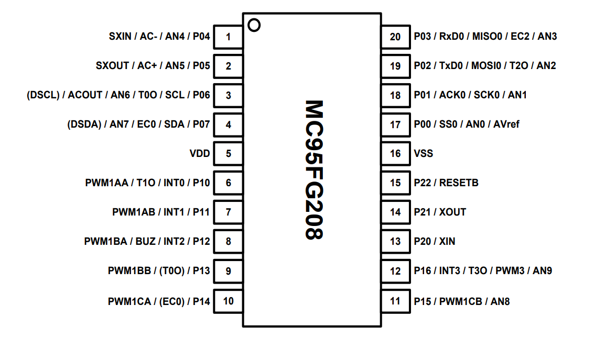

Connection pinout of the U2  :

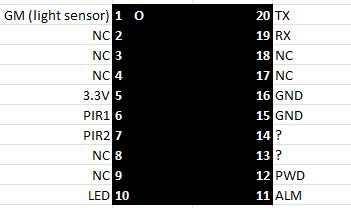

U2 is a microcontroller with :
- 8-bit 8051 CPU
- 8 Kbytes Flash Code Memory
- 512 Bytes EEPROM Backup Memory
- 512 Bytes SRAM Data Memory
- 12-bit Analog to Digital Converter
- Serial Interfaces
- 10-bit PWM channel

Documentation can be found [here](/L620/ressources/MC95FG308-ABOV.pdf)

Used Ports and Functions
- P04 : AN4: Light Sensor
- P10 : : PIR1
- P11 : : PIR2
- P14 : : Led
- P03 : RxT0 : TX Camera
- P02 : TxT0 : RX Camera
- P22 : ResetB : GND
- P15 (pin 11) : PWM1CB : ALM (motion alarm to camera GPIO1_5)
- P16 (pin 12) : PWM3 : PWD (light command to power card)
- P06 / P07 (pins 3 / 4) : DSCL / DSDA : not connected (OCD programming interface)

The communication between the light management card and the camera SoC is serial, using the console serial port.
Communication is only managed from camera to light management card. The light management card doesn't seem to send any data to the module.

All configuration done from the Steinel App (constant light settings) sends a 16-byte frame to the light management module.

Data structure seems to be the following : 

```
42 <2 digits command> <2 digits value> 55 00 <6 digits codes> 00 00 00 00 00 00 00 00
```


```
Resume/quit app:    : 42 46 62 55 00 49 6E 63 00 00 00 00 00 00 00 00 : No action

Light mode : ON     : 42 4D 64 55 00 49 6E 63 00 00 00 00 00 00 00 00 : Switch fixed on light
Light mode : DETECT : 42 4D 62 55 00 49 6E 63 00 00 00 00 00 00 00 00 : Switch off, and active detect mode
Light mode : CONFIG : 42 4D 65 55 00 49 6E 63 00 00 00 00 00 00 00 00 : 

Alarm mode : ON/TON : 42 41 62 55 00 49 6E 63 00 00 00 00 00 00 00 00 : 
Alarm mode : OFF    : 42 41 7A 55 00 49 6E 63 00 00 00 00 00 00 00 00

Dist detect :     0% : 42 44 61 55 00 72 67 65 00 00 00 00 00 00 00 00  
                          62-78
Dist detect :   100% : 42 44 79 55 00 72 67 65 00 00 00 00 00 00 00 00

Sensor     : moon   : 42 58 61 55 00 72 67 65 00 00 00 00 00 00 00 00
                          62-76
Sensor     : sun    : 42 58 77 55 00 72 67 65 00 00 00 00 00 00 00 00

Niveau     :    30% : 42 48 68 55 00 72 67 65 00 00 00 00 00 00 00 00
                          69-79
Niveau     :   100% : 42 48 7A 55 00 72 67 65 00 00 00 00 00 00 00 00
                        
Temporisa  :   1min : 42 54 62 55 00 72 67 65 00 00 00 00 00 00 00 00
Temporisa  :   3min : 42 54 64 55 00 72 67 65 00 00 00 00 00 00 00 00                         
Temporisa  :  10min : 42 54 6B 55 00 72 67 65 00 00 00 00 00 00 00 00                         
Temporisa  :  15min : 42 54 70 55 00 72 67 65 00 00 00 00 00 00 00 00 

Basic Light: ON/OFF : 42 4C 61 55 00 72 67 65 00 00 00 00 00 00 00 00
                       
Basic Light: disable: 42 4C 61 55 00 72 67 65 00 00 00 00 00 00 00 00
                          62-6B
Basic Light:    40% : 42 4C 6C 55 00 72 67 65 00 00 00 00 00 00 00 00 

Tps lum con: Allnigh: 42 53 61 55 00 72 67 65 00 00 00 00 00 00 00 00  
Tps lum con:     2h : 42 53 66 55 00 72 67 65 00 00 00 00 00 00 00 00                         
Tps lum con:     4h : 42 53 6B 55 00 72 67 65 00 00 00 00 00 00 00 00                         
Tps lum con:     6h : 42 53 70 55 00 72 67 65 00 00 00 00 00 00 00 00                         
Tps lum con:    10h : 42 53 7A 55 00 72 67 65 00 00 00 00 00 00 00 00  
```

After additional investigation, there seem to be differences between L620 and L620 SC:
- L620 SC : Message is sent once
- L620 : Message is sent 3 times, but with 3 different '6 digits code'

Firmware 20230322 has improved light control. Between each command, an update command is sent.

```
42 <2 digits command> <2 digits value> 55 00 <6 digits codes> 00 00 00 00 00 00 00 00
42 46 62 55 00 <6 digits codes> 00 00 00 00 00 00 00 00
42 <2 digits command> <2 digits value> 55 00 <6 digits codes> 00 00 00 00 00 00 00 00
42 46 62 55 00 <6 digits codes> 00 00 00 00 00 00 00 00
42 <2 digits command> <2 digits value> 55 00 <6 digits codes> 00 00 00 00 00 00 00 00
42 46 62 55 00 <6 digits codes> 00 00 00 00 00 00 00 00

6 digits codes:
- 49 6E 63
- 72 67 65
- 75 65 00
- 72 79 00
- 00 00 00
- 00 79 00

(55 CC 00 06 00 05 7F 03 00 01 74 23)
```

## OpenIPC installation using serial console

This installation method needs physical access to the serial port, and therefore dismounting the camera.

Insert a SD Card in FAT32 format with the following OpenIPC bin file :
- u-boot : u-boot-hi3518ev300-universal.bin
- rootfs : rootfs.squashfs.hi3518ev300 (utltimate version)
- uImage : uImage.hi3518ev300

Source : https://openipc.org/cameras/vendors/hisilicon/socs/hi3518ev300

### updating u-boot

Insert SD card, and press Ctrl+c to enter original u-boot

```
# clear ram
mw.b 0x42000000 ff 0x50000

# read sd card to ram
fatload mmc 0:1 0x42000000 u-boot-hi3518ev300-universal.bin

# select rom
sf probe 0;

# unlock rom
sf lock 0;

# erase rom
sf erase 0x0 0x50000;

# write ram to rom
sf write 0x42000000 0x0 0x50000;

# restart
reset
```

### updating kernel

Prepare rom

```
run setnor16m
```

Install uImage

```
# clear ram
mw.b 0x42000000 ff 0x1000000;

# read sd card to ram
fatload mmc 0:1 0x42000000 uimage.hi3518ev300;

# select rom
sf probe 0; 

# erase rom
sf erase 0x50000 0x300000;

# write ram to rom
sf write 0x42000000 0x50000 0x300000;
```

Install rootfs

```
# clear ram
mw.b 0x42000000 ff 0x1000000;

# read sd card to ram
fatload mmc 0:1 0x42000000 rootfs.squashfs.hi3518ev300;

# select rom
sf probe 0; 

# erase rom
sf erase 0x350000 0xa00000;

# write ram to rom
sf write 0x42000000 0x350000 0xa00000;
```

First boot

From u-boot, restart the Camera

```
# Reboot the camera
reset
```

After restart, the kernel should run after u-boot. Login in the kernel with :

```
login : root
password : <blank>
```

Enter the following command
```
firstboot
```


## Wi-Fi card activation

The RTL8188FU Wifi card is natively managed by the OpenIPC ultimate version (not in the lite version) but needs to be activated. Edit the file /etc/network/interfaces with vi

```
vi /etc/network/interfaces
```

replace wlan0 section with the following (replace SSID and password)

```
auto wlan0
iface wlan0 inet dhcp
    pre-up modprobe rtl8188fu
    pre-up wpa_passphrase "SSID" "password" >/tmp/wpa_supplicant.conf
    pre-up sed -i '2i \\tscan_ssid=1' /tmp/wpa_supplicant.conf
    pre-up sleep 3
    pre-up wpa_supplicant -B -D nl80211 -i wlan0 -c/tmp/wpa_supplicant.conf
    post-down killall -q wpa_supplicant
```

Reboot the camera and connect to the camera web interface

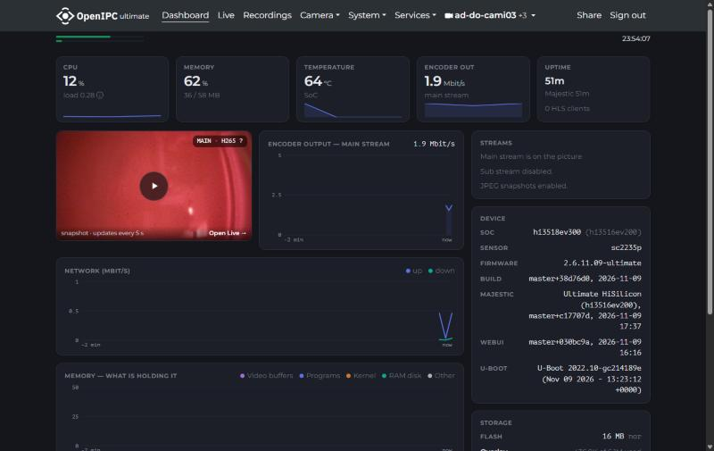

## sensor activation

Sensor is automatically detected by OpenIPC and the following environment variable is added to u-boot
```
...
hisilicon: Get data from environment and set SENSOR as sc2315e
...
```

If we show u-boot environment variables (fw_printenv from the kernel), the following line is added:

For L620 SC
```
sensor=sc2315e
```

For L620
```
sensor=sc2235p
```

20:57:33  <       majestic> [     hal] hisi_free_mem_ex@755          Free MMZ mem finally: 9536KB

## Memory fine tunning

L620 has 64MB RAM onboard. This memory is used for OS but also for MMZ (media memory zone). This memory area is used for image calculation.
In OpenIPC, the media application `majestic` control VB (Video Buffer) that use this memory.

The variable `osmem` in u-boot environment set the memory limit used by linux. Then the rest is available for MMZ.
In original firmware `osmem=43MB`, in OpenIPC after fresh installation `osmem=32MB`.

We then need to check the good parameter for `osmem`. MMZ size need can be affected by `majestic` parameters.

It is possible to check MMZ usage with the `majestic` output. Connect with SSH, then kill and restart majestic from the command line.

```
kill `pidof majestic`

majestic
```

Check the output of majestic and find the line `Free MMZ mem finally: <mem>`.
With `osmem=32MB` and default `majestic` parameters, the output give `Free MMZ mem finally: 9984KB`. This means that we can increase osmem by up to 9MB without affecting MMZ usage.

By setting `osmem=34MB` we have a well adjusted memory parameter.

Command to change osmem from kernel:

```
fw_setenv osmem 34MB
```


## module development for light extension card

A specific application is developed to manage the light extension card and allow remote control. See [lightcam-application](https://github.com/dirandad/lightcamera-openipc/tree/main/lightcam-application)

## Migration Procedure

Based on all previous analysis, here is the full and detailed migration procedure from Steinel Firmware of 20220712 to a configured and customed OpenIPC firmware (tested with 2.2.12.26) without even opening the camera.

This migration was first based on [Coupler](https://github.com/OpenIPC/coupler) method, but as a better option, migration is now based on ```ipctool upgrade``` function. This function will use a specific bundle that we will create in the next step.

### 0. Prerequisites

Before to start the upgrade procedure, you need to have the following:
- The Steinel L620 SC Camera running with official firmware and configured
- An SD Card of 32 GB or less, that you can format in FAT32 (see [1. Format SD Card](#1-format-sd-card))
- ipctool : [ipctool](https://github.com/OpenIPC/ipctool)
- 7-Zip installed : [7-Zip](https://www.7-zip.org/)
- Last OpenIPC firmware for HI3518EV300 in ultimate version : [openipc.hi3518ev300-nor-ultimate.tgz](https://github.com/OpenIPC/firmware/releases/download/latest/openipc.hi3518ev300-nor-ultimate.tgz)

### 1. Format SD Card

Two different SD Card layouts are needed in this procedure:

| Steps | Firmware reading the card | Layout | Seen by the camera as |
|---|---|---|---|
| 2 and 4 (backup, upgrade) | Steinel firmware | **FAT32 on the whole card, no partition table** | `/dev/mmcblk0` |
| 5 (OpenIPC configuration) | OpenIPC | FAT32 in one primary partition | `/dev/mmcblk0p1` |

Use a card of 32 GB or less: Windows cannot format a bigger card in FAT32.

> **Why the layout matters.** At boot, the Steinel `/etc/init.d/rcS` runs `mount /dev/mmcblk0` (the whole card) and only then looks for `xm_autorun.sh`. On a partitioned card this mount fails, the script is not found, and the camera **reformats the card**: you get back a card that Windows cannot read and no backup. This is the most common reason why "the script does not start" (issues #2 and #14). Tested on 2026-11-08 with Steinel firmware `V4.03.R12.Nat.20230322`: a partitioned FAT32 card was reformatted, and the same card in the whole-card layout ran the script.

#### 1.1. Card for the Steinel firmware (steps 2 and 4): FAT32 on the whole card

**Windows (no administrator rights needed):**
1. Insert the card in the camera, switch the camera on, and wait 2 minutes. The camera formats the card on the whole device.
2. Insert the card in the Windows PC. Ignore the message asking to format it.
3. Note the drive letter of the card, then run in a command prompt (replace `G:` with your letter):

   ```
   format G: /FS:FAT32 /Q /V:L620 /Y
   ```

   This formats the volume the camera created, without creating a partition table.

**Linux** (replace `/dev/sdX` with your card, and check it twice with `lsblk`: this erases the whole device):

```
sudo wipefs -a /dev/sdX
sudo mkfs.vfat -F 32 -I -n L620 /dev/sdX
```

Note the `-I` and the device name without a partition number (`/dev/sdX`, not `/dev/sdX1`).

**Check the layout** (Windows PowerShell, replace `2` with the disk number of the card from `Get-Disk`):

```
Get-Partition -DiskNumber 2 | Select-Object DriveLetter, Offset
```

`Offset 0` means FAT32 on the whole card (correct for the Steinel firmware). `Offset 1048576` means a partitioned card (correct for OpenIPC only).

#### 1.2. Card for OpenIPC (step 5): FAT32 in one primary partition

In a command prompt **run as administrator**:

```
diskpart

list disk
select disk <number corresponding to your SD Card>
detail disk
clean
create partition primary
format quick fs=FAT32
active
assign
exit
```

Check with `detail disk` that the selected disk is the SD Card before typing `clean`: `clean` erases the whole disk.

Recent OpenIPC versions also mount a card without partition table, but this was not tested on the OpenIPC versions installed by this procedure. With some OpenIPC versions, a logical partition was needed instead (issue #14): replace `create partition primary` with `create partition extended` then `create partition logical`.

#### 1.3. Common pitfalls

- Copy the scripts with Unix (LF) line endings. A script with Windows (CRLF) line endings is not executed.
- Safely eject the card before removing it, otherwise the last files written may be missing.
- The camera runs `xm_autorun.sh` at boot. According to `/etc/mdev/automount.sh`, it also runs it when the card is inserted after the boot is complete, on both layouts. This was not tested.

### 2. Backup Original Firmware

2.1. Format the SD Card in FAT32 **on the whole card, without partition table**, as described in [1.1](#11-card-for-the-steinel-firmware-steps-2-and-4-fat32-on-the-whole-card). A partitioned card is reformatted by the camera.

2.2. Copy the content of the [sd-steinel](https://github.com/dirandad/lightcamera-openipc/tree/main/L620/scripts/sd-steinel) structure on the SD Card. Content of the SD Card must be at minimum the following:
```
sd
├── ipctool         // OpenIPC multi tool
└── xm_autorun.sh   // specific script
```

`xm_autorun.sh` is a shell script executed by the Steinel firmware during startup. If this file is not found on the SD Card, the SD Card is automatically formatted. The script does the following, in this order, and writes only to the SD Card except for the last step:
1. Starts the Wi-Fi as if the SD Card was not present (the Steinel `rcS` skips it when the script exists).
2. Collects system information in `diag/`: firmware version (`FirmwareInfo`), partitions, kernel command line, `ipctool` output (SoC, sensor, flash), and copies of the Steinel boot scripts. Wi-Fi keys are not copied.
3. Makes a full backup of the flash with `ipctool backup`, once (an existing backup is not overwritten).
4. Enables `telnetd` on port 23, so that you can connect with the `root:xmhdipc` credentials. This writes the `telnetctrl` variable in the u-boot environment, which is why it is done **after** the backup.

The script was tested on 2026-11-08 with a L620 on Steinel firmware `V4.03.R12.Nat.20230322`.

2.3. Switch Off the Camera and insert the SD Card in Slot

2.4. Switch On the Camera and Wait 5 minutes. The Camera will boot, start the network, and you should be able to connect to the Camera via telnet. Even if it should not be needed in this procedure, it is a good opportunity for investigation if any step of this procedure fails.

2.5. Switch Off the Camera, remove the SD Card and plug it in your computer. You should observe the following files:
```
sd
├── DONE                          // The script reached its end
├── diag
│   ├── run.log                   // What the script did, with timestamps
│   ├── system.txt                // Firmware version, partitions, processes, network
│   ├── ipctool.txt               // SoC, board, flash and sensor
│   ├── ipctool-backup.txt        // Output of the backup command
│   └── rcS.txt, automount.sh.txt, ...
├── firmwaredump-<mac>.bin        // The backup (about 16.0 MB)
├── ipctool
└── xm_autorun.sh
```

If the card comes back reformatted and unreadable by Windows, the script was not executed: check the card layout ([1.1](#11-card-for-the-steinel-firmware-steps-2-and-4-fat32-on-the-whole-card)).

`diag/system.txt` contains camera-specific data (for example the Steinel unlock code in `ProductTrail`). Do not publish it.

**About the backup format.** `ipctool backup` does not write a raw flash image: the file starts with a YAML header (the `ipctool` output), followed by each partition preceded by its size on 4 bytes (little-endian). It is 16777216 bytes plus about 1.5 KB. To restore with u-boot or a CH341A programmer, you need the raw 16 MB image. On Linux (or Git Bash on Windows), this rebuilds it and prints the SHA1 of each partition, to compare with the `sha1` values in `diag/ipctool.txt`:

```
F=firmwaredump-<mac>.bin
pos=$(( $(stat -c %s "$F") - 16777216 - 6*4 ))   # header length
rm -f fulldump-raw.bin
for name in boot romfs user web custom mtd; do
  sz=$(od -A n -t u4 -j $pos -N 4 "$F" | tr -d ' ')
  tail -c +$((pos+5)) "$F" | head -c $sz >> fulldump-raw.bin
  echo "$name size=$sz sha1=$(tail -c +$((pos+5)) "$F" | head -c $sz | sha1sum | cut -c1-8)"
  pos=$((pos+4+sz))
done
ls -l fulldump-raw.bin   # must be 16777216 bytes
```

You can then check the content with ```binwalk -e fulldump-raw.bin```.

### 3. Create a Firmware bundle for ipctool upgrade

Do not start this section if you did not manage to back up the original firmware!

3.1. Clone GitHub ipctool repository and explore it
```
git clone https://github.com/OpenIPC/ipctool

cd ipctool/tools/
```
3.2. Run the following command to create a bundle for L620 including OpenIPC u-boot and corresponding OpenIPC ultimate firmware for a 16MB Flash size camera.

```
./make_images.sh hi3518ev300 ultimate
```

If the script succeeds, you will find the bundle in `/output/upgrade.hi3518ev300`
The firmware is ready to be updated.

### 4. Update firmware using ipctool

4.1. Copy `upgrade.hi3518ev300` on the SD Card. Content of the SD Card must be at minimum the following:

```
sd
├── ipctool
├── upgrade.hi3518ev300
└── xm_autorun.sh
```

4.2. Switch Off the Camera and insert the SD Card in Slot

4.3. Switch On the Camera and Wait 5 minutes. The Camera will boot, active network and you should be able to connect on the Camera via telnet.

4.4. Connect to the camera using telnet using `root:xmhdipc` credential

4.5. Check that the SD Card is available at `/tmp/mmcblock0/`

```
cd /tmp/mmcblock0/

ls -ls
```

4.6. Run the upgrade command. (It may be necessary to run this command twice, depending on the Sofia detection process)

```
/tmp/mmcblock0/ipctool upgrade /tmp/mmcblock0/upgrade.hi3518ev300 --force

There was no Sofia process detected
Using '/tmp/mmcblock0/upgrade.hi3518ev300' as upgrade bundle
        boot    0xb662e010, size: 262144 bytes
        env     0x63010, size: 65536 bytes
        kernel  0xb642d010, size: 2097152 bytes
        rootfs  0xb5d7c010, size: 7012352 bytes
Analyzing boot
Analyzing env
Analyzing kernel
Analyzing rootfs
Upgrading boot
Erase failed, trying XM specific algorithm...ok
Flashing [wwww]
Upgrading env
Flashing [w]
Upgrading kernel
Flashing [wwwwwwwwwwwwwwwwwwwwwwwwwwwwwwww]
Upgrading rootfs
Flashing [wwwwwwwwwwwwwwwwwwwwwwwwwwwwwwwwwwwwwwwwwwwwwwwwwwwwwwwwwwwwwwwwwwwwwwwwwwwwwwwwwwwwww]
set_env_param: total_mem=64M
System will be restarted...
```
4.6. After reboot, switch off the camera and remove the SD Card.

### 5. Configuration of OpenIPC

5.1. Format the SD Card in FAT32 **with one primary partition**, as described in [1.2](#12-card-for-openipc-step-5-fat32-in-one-primary-partition).

5.2. Copy the content of the [sd-openipc](https://github.com/dirandad/lightcamera-openipc/tree/main/L620/scripts/sd-openipc) structure on the SD Card. Content of the SD Card must be at minimum the following:
```
sd
├── autoconfig.sh                // autoconfig script
└── autoconfig
    ├── etc
    │   ├── init.d
    │   │   └── S50lightcam      // start/stop script for lightcam
    │   ├── lightcam.yml         // configuration file of lightcam. MUST be adapted
    │   └── network
    │       └── interfaces       // network and wlan configuration. MUST be adapted
    └── usr
        └── sbin
            └── lightcam         // lightcam binary. Sources are provided.
```

`autoconfig.sh` is a script that will make the following configuration:
- set u-boot variable `osmem` to 34MB
- remove serial output of console from u-boot variable `bootargs`

The script edits `bootargs` in place and keeps the partition layout (`mtdparts`, `root=`) written by the upgrade bundle. It writes a log `autoconfig.log` on the SD Card, and OpenIPC deletes `autoconfig.sh` after running it.

> **Warning: older versions of `autoconfig.sh` can brick the camera at the second boot.**
> Before November 2026, `autoconfig.sh` rewrote `bootargs` with a hardcoded layout (`3072k(kernel),10240k(rootfs)`). The packed upgrade bundle writes a 2 MB kernel, so with that line the kernel looks for the rootfs at the wrong offset. The first boot works, because the change only applies at the next reboot (for example after setting the timezone in the web interface). From then on the kernel panics and the camera reboots every 20 seconds (`panic=20`). See issues #7 and #19.
> If your camera is still running, check it with `cat /proc/mtd` and `fw_printenv bootargs`: `/proc/mtd` shows the layout of the current, working boot, and `bootargs` the one used at the next boot. The kernel partition size must be the same in both (`0x200000` = 2048k, `0x300000` = 3072k). If it differs, fix `bootargs` before rebooting. If the camera is already looping, recovery needs the serial console. The procedure confirmed in issue #19 is to flash the full OpenIPC image from u-boot, then `run setnor16m`.

Scripts must use Unix (LF) line endings. A script with Windows (CRLF) line endings is silently ignored by the camera. The repository enforces LF with `.gitattributes`. If you edit the files on Windows, check the line endings before copying them to the SD Card.


5.3. Switch Off the Camera and insert the SD Card in Slot

5.4. Switch On the Camera and Wait 5 minutes.

At this point it should be possible to connect the Camera url ```http://<ip>:85/```.


5.5. connect to the webinterface and set `admin` password and confirm. This password is used for `root` in linux.

5.6. In the webinterface go to `Device status` page and click `Change timezone`. In the Timezone page, click `Pick up timezone from browser` and click `Save changes`.

The camera should now be ready !


