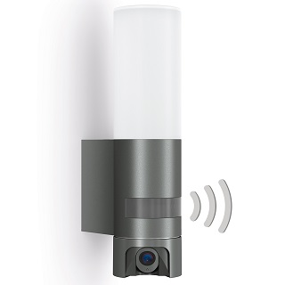

# lightcamera-openipc
Install OpenIPC on Light Camera (Lutec, Steinel)

## Introduction

This project tries to install [OpenIPC](https://openipc.org/) on Light Camera. Any help will be useful.

### Light Camera should be :
- Steinel L600
- [Steinel L620 (SC)](/L620/README.md)
- Steinel XLED Cam 1
- Lutec Elara

These cameras are typically based on:
- Hisilicon SoC : HI3518EV200 or HI3518EV300
- A light extension card based on a microchip (GX20-2120)
- Wifi based camera (no RJ45 port)
- Sensor
- Original firmware is cloud based, using a smartphone application. The camera cannot be used locally only

### Objectives of the project:
- [ ] Install [OpenIPC](https://openipc.org/) on the camera (Open source IP Camera firmware that gives full local access to the camera). OpenIPC installation should be SD Card based, as dismounting the camera can be hard, and sometimes definitive. OpenIPC includes a lot of IP camera functionalities.
- [ ] Active Wifi Card and networking
- [ ] Active Sensor
- Manage communication with light extension card over webservice
    - [ ] Expose detector status
    - [ ] give light control : ON/OFF/Variable
    - [ ] manage light parameters : ON/OFF management, Light %,...
    - [ ] Manage detector parameters: sensitivity, duration,...

Project will be started with a Steinel L620 SC camera.

### Steps for each camera type

- Camera dismounting and hardware identification
- identification of console serial port and connection
- original firmware analysis
- light management extension card analysis
- OpenIPC installation using console
- Wi-Fi card activation
- sensor activation
- module development for light extension card
- module integration in OpenIPC
- script development to automate firmware installation using SD card

## OpenIPC

## Introduction

[OpenIPC](https://openipc.org/) is an Open Source firmware for IPC Camera. It is Linux based and fits on SoCs with at least 8MB Flash.
Two versions are available as standard:
- Lite: for 8MB systems, contains the minimum of functions for small systems
- Ultimate: needs at least a 16MB system. The Ultimate version contains more functions and drivers (wifi drivers,...)

It is still possible to build a custom firmware with selected modules and options.

## Compatibility

OpenIPC is compatible with some SoCs, but not all. [Compatible Hardware](https://openipc.org/supported-hardware/featured) is listed on the OpenIPC website.
HiSilicon SoCs are highly compatible.

## Installation

There are several ways to install OpenIPC. Here is the list of the most common ways:
- Using Serial port and u-boot. u-boot has various commands to read and write firmware to flash. Firmware can be loaded from the following sources:
    - SD Card: if the SoC has SD Card slot
    - USB Key: if the SoC has USB port
    - Remote TFTP Server: if the SoC has an ethernet port
    - Serial communication
- Using original firmware update software. This is brand specific. OpenIPC provides a firmware package for this usage. See [Coupler](https://github.com/OpenIPC/coupler). This method doesn't need to disassemble the camera.
- Using [ipctool](https://github.com/OpenIPC/ipctool) upgrade function and a specific firmware package. This method doesn't need to disassemble the camera.
- Using a programmer and a CH341a tool directly connected to the flash component. This is the last-chance technique, as it can be used even when the camera does not start. OpenIPC provides a specific firmware package for programmers.

