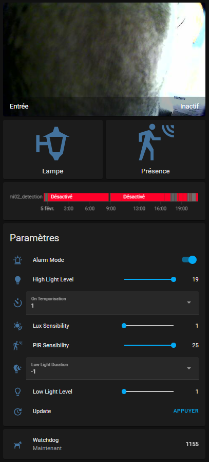

# lightcam-application

Embedded application developed in C to expose/manage the light extension card.

## Introduction

The application has the following functionalities:

- Manage YAML file
  - configuration for MQTT server
  - configuration for Serial port

- Manage Serial communication with extension card
  - Send configuration using Bytes array

- Manage register configuration
  - Read and Write GPIO (Read Value, Write Value, Write Direction)
  - Configure register values

- Manage Leds
  - Switch On and Off Led with application Status

- Manage Alarm (detector) status
  - Retrieve detector status

- Integrate a MQTT Client
  - Send Watchdog to MQTT Server
  - Receive Light Configuration from MQTT Server and send it to serial
  - Send detector status to MQTT Server

## Version 2 (November 2026)

The MQTT topics of version 1 are unchanged: an existing Home Assistant configuration keeps working. Changes:

- **Fixes**:
  - the lux sensibility was sent with the PIR command (`0x44`): setting `LuxSensibility` changed the PIR distance. The lux command is `0x58`;
  - memory leak of the status LED: each call restarted the blinking thread without joining the old one (the red blinking was disabled for this reason), and the thread used its arguments after freeing them;
  - stack overflow at each publication of the configuration (`char[2]` buffer for 2-digit values);
  - the connection to the broker blocked the whole application for about 2 minutes when the broker did not answer (blocking `connect()`); it now times out after 5 s and retries after 10, 20, 40 then 60 s, and the detection and the MCU check go on meanwhile;
  - the MQTT password is no longer written in the log;
  - GPIO read compared with `strcmp` on a non-terminated string; register access from two threads without lock.
- **Light card status**: every 60 s, and 2 s after each change, lightcam sends the update command and reads the status frame of the MCU, publishes it on `{basetopic}/Get/Status`, and sends the configuration again when the MCU does not have it (for example after a reset of the light card, issue #20). At most 3 tries in a row.
- **Availability**: Last Will on `{basetopic}/Availability` (`online` / `offline`, retained): Home Assistant shows the camera as unavailable when lightcam or the camera stops.
- **States** are published with QoS 1 and retained: Home Assistant has them at once after a restart.
- **Home Assistant MQTT discovery**, optional (`discovery: true`): the camera appears as a device with all its entities, without YAML.
- **Version 2.0.1**: the MQTT client ID and the Home Assistant identifiers come from the base topic (`lightcam-<topic>`) instead of the host name, which is the same on every camera installed with the default settings (two clients with the same ID disconnect each other in a loop); lightcam stops at once on SIGTERM (it waited forever for the GPIO thread, so `S50lightcam stop` left it running).

Tested on 2026-11-09 on OpenIPC 2.3.04.14 (`ad-do-cami04`) and 2.6.11.08 (test camera).

## Prepare development environment

The development environment is a cross compilation environment. In this case, it is based on:
- Ubuntu 22.04 WSL on Windows 11
- Toolchain for OpenIPC to be able to compile c code for OpenIPC

```
$ wget https://github.com/OpenIPC/firmware/releases/download/latest/cortex_a7_thumb2-gcc8.4.0-musl-4_9-1e913a17.tgz

$ tar zxvf cortex_a7_thumb2-gcc8.4.0-musl-4_9-1e913a17.tgz

$ cd arm-openipc-linux-musleabi_sdk-buildroot/

$ ./relocate-sdk.sh
```

## Build application

Application can be compiled using the following instructions

```
$ git clone https://github.com/dirandad/lightcamera-openipc/

$ cd ~/lightcamera-openipc/lightcam-application/src/

$ TOOLCHAIN_PATH=~/arm-openipc-linux-musleabi_sdk-buildroot/bin sh build_lightcam.sh
```

With a camera IP as argument, the script also copies the binary to the camera over SSH and restarts lightcam:

```
$ TOOLCHAIN_PATH=~/arm-openipc-linux-musleabi_sdk-buildroot/bin sh build_lightcam.sh 192.168.1.10
```

The build is reproducible: with the 2023 toolchain above, the sources of this folder give the `lightcam` binary of this folder and of `L620/scripts/sd-openipc/autoconfig/usr/sbin/` (version 2.0.1, MD5 `d313e9c0e009f05483bdc0c66c030ad8`).

## Installation

The migration procedure installs lightcam from the SD card (see `L620/README.md`, Migration Procedure): put your `lightcam.yml` in `autoconfig/etc/` on the card.

To install it by hand on an OpenIPC camera, copy the following files:
- `lightcam` 		--> `/usr/sbin/` (mode 755)
- `S50lightcam`		--> `/etc/init.d/` (mode 755)
- `lightcamwd.sh`	--> `/etc/` (mode 755, see [Watchdog](#watchdog-and-autorestart))
- `lightcam.yml`	--> `/etc/` (mode 600: it holds the MQTT password)

`/dev/ttyAMA0` must be used by lightcam only. On recent OpenIPC versions the kernel console falls back to `ttyAMA0` when `bootargs` has no `console=`, and a login prompt (`getty`) runs on the console: set `console=null` in `bootargs` and comment the `getty` line of `/etc/inittab` (the SD card procedure does both).

## Usage

To start lightcam manually enter the following command (adapt configuration file path if needed):

```
/usr/sbin/lightcam /etc/lightcam.yml
```

To manage lightcam using `init.d`:

```
/etc/init.d/S50lightcam start
/etc/init.d/S50lightcam stop
/etc/init.d/S50lightcam restart
```

### Configuration

Basic configuration of lightcam is done using a YAML file and contains:
- MQTT server configuration including the detector timeout
- serial configuration

```
mqtt: 
    server: "192.168.1.1"
    port: 1883
    username: "username"
    password: "password"
    topic: "cameraip"
    detectortempo: 60.0
    discovery: false
    discoveryprefix: "homeassistant"
serial: 
    port: "/dev/ttyAMA0"
    baudrate: 9600
```

- `topic`: base topic of the camera, different for each camera. It is also the name of the device in Home Assistant.
- `detectortempo`: seconds `Get/Detection` stays at `1` after the last PIR pulse.
- `discovery` (version 2): `true` to publish the Home Assistant MQTT discovery messages. Leave `false` if the camera is already configured in YAML in Home Assistant, to avoid duplicate entities.
- `discoveryprefix` (version 2): discovery prefix of Home Assistant, `homeassistant` by default.

### MQTT topics

in this section, `{basetopic}` is configured in YAML configuration file at `mqtt.topic`.

lightcam will subscribe on the following MQTT topics:

```
{basetopic}/Set/Update
{basetopic}/Set/LightMode={on,detect,config}
{basetopic}/Set/AlarmMode={on,off}
{basetopic}/Set/PirSensibility={1-25}
{basetopic}/Set/LuxSensibility={1-23}
{basetopic}/Set/HighLightLevel={1-19}
{basetopic}/Set/OnTemporisation={1,3,10,15}
{basetopic}/Set/LowLightLevel={1-12}
{basetopic}/Set/LowLightDuration={-1,2,4,6,10}
```

lightcam will publish on the following MQTT topics:

```
// updated each 5 sec
{basetopic}/Watchdog={0-32000}

// version 2, retained: "online" at connection, "offline" sent by the broker (Last Will)
// when the camera disappears, or by lightcam when it stops
{basetopic}/Availability={online,offline}

// version 2, each 60 sec and 2 sec after a change: the 10 status bytes of the MCU in
// hexadecimal, or "noanswer"
{basetopic}/Get/Status=<10 bytes in hex>|noanswer

// set to 1 when GPIO 1_5 activated, reset to 0 at end of temporisation mqtt.detectortempo after last activation of GPIO 1_5	
{basetopic}/Get/Detection={0,1}

// updated each 60 sec or after reception of new message on a subscribed topic.
{basetopic}/Get/LightMode={on,detect,config}
{basetopic}/Get/AlarmMode={on,off}
{basetopic}/Get/PirSensibility={1-25}
{basetopic}/Get/LuxSensibility={1-23}
{basetopic}/Get/HighLightLevel={1-19}
{basetopic}/Get/OnTemporisation={1,3,10,15}
{basetopic}/Get/LowLightLevel={1-12}
{basetopic}/Get/LowLightDuration={-1,2,4,6,10}
```

## Integration

### Home Assistant Integration

As a prerequisite, you need to add the MQTT integration to Home Assistant.

**With MQTT discovery (version 2, recommended).** Set `discovery: true` in `lightcam.yml`. The camera appears in Home Assistant (Settings, Devices & services, MQTT) as a device named after its base topic, with: detection (motion), light mode, alarm mode, PIR, lux, high and low light levels, temporisations, an update button and the MCU status. Its entities become unavailable when the camera is offline. Remove the YAML configuration below for this camera, if any, to avoid duplicates.

**Without discovery**, here is an example of manual integration in Home Assistant, based on the MQTT topics.



extract of `configuration.yaml` file. Replace `camera` with your specific name.
```
mqtt:
    sensor:  
      - unique_id: camera_watchdog
        name: "camera_watchdog"
        state_topic: "camera/Watchdog"
        expire_after: 10
    binary_sensor:
      - unique_id: camera_detection
        name: "camera_detection"
        state_topic: "camera/Get/Detection"
        payload_on: "1"
        payload_off: "0"
    light:
      - unique_id: camera_light
        name: "camera_light"
        schema: template
        command_topic: "camera/Set/LightMode"
        command_on_template: "on"
        command_off_template: "detect"
        state_topic: "camera/Get/LightMode"
        state_template: "onoff"
    button:
      - unique_id: camera_update
        name: "camera_update"
        command_topic: "camera/Set/Update"
    switch:
      - unique_id: camera_alarmmode
        name: "camera_alarmmode"
        command_topic: "camera/Set/AlarmMode"
        state_topic: "camera/Get/AlarmMode"
        payload_on: "on"
        payload_off: "off"
    select:
      - unique_id: camera_ontemporisation
        name: "camera_ontemporisation"
        command_topic: "camera/Set/OnTemporisation"
        options:
          - "1"
          - "3"
          - "10"
          - "15"
      - unique_id: camera_lowlightduration
        name: "camera_lowlightduration"
        command_topic: "camera/Set/LowLightDuration"
        options:
          - "-1"
          - "2"
          - "4"
          - "6"
          - "10"
    number:
      - unique_id: camera_pirsensibility
        name: "camera_pirsensibility"
        command_topic: "camera/Set/PirSensibility"
        state_topic: "camera/Get/PirSensibility"
        min: 1
        max: 25
        step: 1
      - unique_id: camera_luxsensibility
        name: "camera_luxsensibility"
        command_topic: "camera/Set/LuxSensibility"
        state_topic: "camera/Get/LuxSensibility"
        min: 1
        max: 23
        step: 1
      - unique_id: camera_highlightlevel
        name: "camera_highlightlevel"
        command_topic: "camera/Set/HighLightLevel"
        state_topic: "camera/Get/HighLightLevel"
        min: 1
        max: 19
        step: 1
      - unique_id: camera_lowlightlevel
        name: "camera_lowlightlevel"
        command_topic: "camera/Set/LowLightLevel"
        state_topic: "camera/Get/LowLightLevel"
        min: 1
        max: 12
        step: 1

```

## Watchdog and Autorestart

The script [`src/lightcamwd.sh`](src/lightcamwd.sh), installed as `/etc/lightcamwd.sh`, checks if lightcam is running and starts it again if it is not (the file was named `lightcamwg.sh` in this repository before November 2026). The SD card procedure installs it and adds it to cron.

To autostart this script each minute, the following line must be added to crontab configuration file `/etc/crontabs/root`

```
# .---------------- minute (0 - 59)
# |    .------------- hour (0 - 23)
# |    |      .---------- day of month (1 - 31)
# |    |      |     .------- month (1 - 12) OR jan,feb,mar,apr ...
# |    |      |     |     .---- day of week (0 - 6) (Sunday=0 or 7) OR sun,mon,t
# |    |      |     |     |
# *    *      *     *     *     command to be executed

*      *      *     *     *     /etc/lightcamwd.sh
```
## Resources and Reference

LightCam uses the following sources:
- Embedded C MQTT Client: [Paho MQTT Client](https://www.eclipse.org/paho/index.php?page=clients/c/embedded/index.php)
- YAML code : [Yaml code](https://github.com/tlsa/libcyaml)


